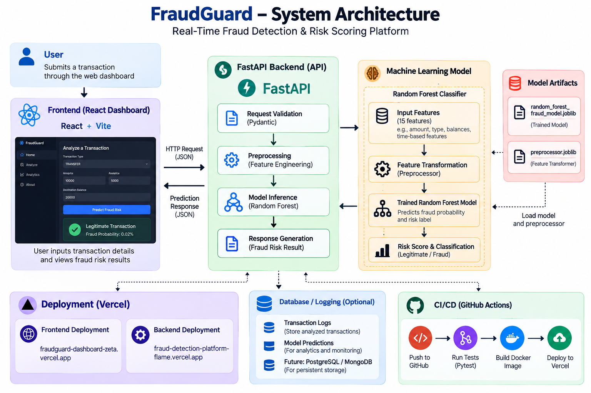
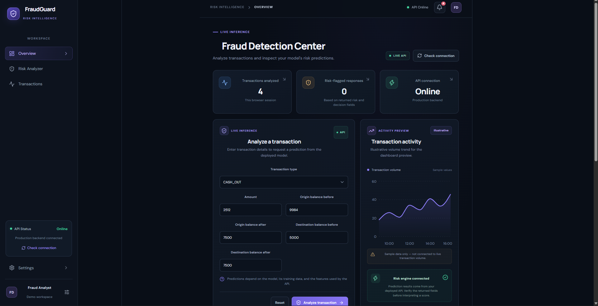

# FraudGuard — Real-Time Fraud Detection & Risk Scoring Platform

FraudGuard is a full-stack machine learning application that analyzes financial transactions and predicts fraud risk through a web dashboard and REST API.

The project combines a trained Random Forest model, a FastAPI inference service, a React dashboard, containerization, and automated CI/CD workflows.

## Live Demo

- **Dashboard:** https://fraudguard-dashboard-zeta.vercel.app
- **Backend API:** https://fraud-detection-platform-flame.vercel.app
- **API Documentation:** https://fraud-detection-platform-flame.vercel.app/docs

## Features

- Transaction-level fraud prediction through a REST API
- Machine learning inference using a trained Random Forest model
- Feature preprocessing before model inference
- Risk assessment results displayed in a React dashboard
- API health-check endpoint
- Request validation and error handling
- Docker-based containerization
- Automated testing and CI/CD with GitHub Actions
- Cloud deployment for the frontend and backend


## Dashboard Preview

FraudGuard provides a web interface for analyzing transactions and viewing fraud-risk predictions.


## System Architecture

FraudGuard processes transactions through a React frontend, FastAPI backend, and trained Random Forest model. The backend validates incoming requests, applies preprocessing, performs model inference, and returns a fraud-risk result.



### Overview



**Live Demo:** https://fraudguard-dashboard-zeta.vercel.app
## Architecture

```text
              User
               |
               v
       React Dashboard
               |
          HTTPS / JSON
               |
               v
        FastAPI Backend
               |
               v
       Input Validation
               |
               v
        Preprocessing
               |
               v
       Random Forest Model
               |
               v
       Fraud Risk Result
               |
               v
       Dashboard Display
```

## Technology Stack

| Component | Technologies |
|---|---|
| Machine Learning | Python, scikit-learn, Random Forest |
| Data Processing | Pandas, NumPy |
| Backend | FastAPI, Pydantic, Uvicorn |
| Frontend | React, Vite, JavaScript |
| Model Persistence | Joblib |
| Testing | Pytest |
| Containerization | Docker |
| CI/CD | GitHub Actions |
| Deployment | Vercel |
| Version Control | Git, GitHub |

## Project Structure

```text
fraud-detection-platform/
├── api/
│   └── main.py
├── configs/
│   └── model_features.py
├── models/
│   ├── random_forest_fraud_model.joblib
│   └── preprocessor.joblib
├── src/
│   └── inference/
│       ├── model_predictor.py
│       └── risk_engine.py
├── tests/
├── frontend/
│   └── src/
│       └── App.jsx
├── .github/
│   └── workflows/
│       └── ci.yml
├── Dockerfile
├── requirements-ci.txt
└── README.md
```

*The structure above highlights the main components; additional files may exist in the repository.*

## Getting Started

### Prerequisites

- Python
- Node.js and npm
- Git

### 1. Clone the repository

```bash
git clone https://github.com/hemanthj799/fraud-detection-platform.git
cd fraud-detection-platform
```

### 2. Set up the backend

Create and activate a virtual environment.

**Windows PowerShell:**

```powershell
python -m venv .venv
.\.venv\Scripts\Activate.ps1
pip install -r requirements-ci.txt
```

Start the API from the project root:

```powershell
uvicorn api.main:app --reload
```

The backend should be available at `http://127.0.0.1:8000`.

Interactive API documentation: `http://127.0.0.1:8000/docs`

### 3. Set up the frontend

Open another terminal:

```powershell
cd frontend
npm install
npm run dev
```

Open the local URL printed by Vite, typically `http://localhost:5173`.

Ensure the frontend API URL points to the backend you want to test.

### 4. Run tests

From the project root, activate the virtual environment and run:

```powershell
python -m pytest tests/test_api.py tests/test_risk_engine.py -v
```

## Model Evaluation

FraudGuard uses a trained Random Forest classifier for transaction fraud prediction.

Evaluate the model using a held-out test dataset and report precision, recall, F1-score, PR-AUC, and ROC-AUC. Add verified test-set results here before publishing performance claims.

## Engineering Considerations

- Fraud datasets are typically highly imbalanced, so precision-recall metrics are important.
- Predictions depend on the quality of input features and the training data.
- The current model is a project prototype, not a validated production banking fraud system.
- Model performance on a benchmark dataset does not guarantee performance on real financial transactions.

## Future Improvements

- Add model explainability to show factors influencing individual predictions.
- Introduce monitoring for prediction latency and model performance.
- Add persistent transaction history and analytics.
- Improve automated model evaluation and drift detection.
- Optimize frontend bundle size and API response handling.

## Disclaimer

This project is intended for educational and demonstration purposes. It should not be used to make real financial decisions without additional validation, security controls, and operational testing.

## Author

**Hemanth Javalgeri**

- GitHub: https://github.com/hemanthj799
- LinkedIn: https://www.linkedin.com/in/hemanth-javalgeri-731210310
